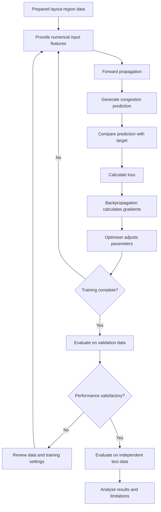

# Mission 4 — How Does a Neural Network Learn?

## 1. Introduction

A neural network learns by identifying relationships between input data and expected outputs. It begins with adjustable parameters and gradually modifies them based on feedback from its predictions.

To understand this process in Physical Design, consider a model that identifies whether a region of a chip layout is likely to experience routing congestion.

The network can learn from previously analysed layout regions and their congestion labels. By studying these examples, it attempts to recognise combinations of placement density, cell distribution, and routing demand that are associated with congestion.

## 2. Understanding the Forward Pass

The forward pass is the stage in which a neural network receives information and processes it to generate an output.

Consider a chip layout divided into smaller regions.

1. Each region is represented using numerical information, such as cell density and estimated routing demand.
2. These values are supplied to the input layer.
3. Neurons in the hidden layers combine the input values using weights and biases.
4. Activation functions help the network learn relationships that may not be simple linear patterns.
5. The output layer produces a result indicating the estimated congestion category.

For example, the network might predict that a particular layout region has a high probability of congestion.

At this stage, the network has only produced an estimate. It still needs feedback to determine how close its prediction is to the expected result.

## 3. Understanding Prediction Error

During supervised learning, every training example contains input information and an expected output.

The network's output is compared with the expected answer to determine how well it performed.

A **loss function** converts the difference between the predicted output and the target into a numerical measure.

Consider this illustrative example:

- Input: Numerical placement information from a chip region.
- Actual label: High congestion.
- Network prediction: Low congestion.
- Observation: The model has predicted the wrong category.

The loss function measures this prediction error according to the selected learning objective.

A smaller loss generally indicates that predictions are closer to their targets. However, one training example cannot establish whether the complete model is accurate.

## 4. How Backpropagation Helps Learning

Backpropagation is the method used to calculate gradients that describe how changes in the network's parameters affect its loss.

It sends error-related information backwards through the network, starting from the output layer.

The process can be understood as follows:

1. The network generates an output from the input features.
2. The loss function measures the difference between the output and the expected result.
3. Gradients are calculated for the trainable weights and biases.
4. These gradients indicate how the parameters influence the loss.
5. The calculated gradients are passed to the optimisation algorithm for parameter adjustment.

This gives the network a mathematical way to improve its predictions instead of changing its parameters randomly.

## 5. Role of the Optimiser and Learning Rate

After calculating gradients, the network needs a method to update its parameters. This is the role of an optimiser.

Gradient descent is one commonly used optimisation method. It adjusts the parameters in a direction intended to decrease the loss.

The **learning rate** determines how large each parameter update should be.

Its effect can be understood through three situations:

- **Very high learning rate:** The model may make large adjustments and fail to settle into a useful solution.
- **Very low learning rate:** The model may require many updates to make meaningful progress.
- **Appropriate learning rate:** The model can make more controlled adjustments during training.

The optimiser repeatedly uses gradient information to update the network. The objective is to find parameter values that allow the model to make useful predictions on data beyond its training examples.

## 6. Understanding Epochs and Iterations

An epoch and an iteration are related concepts, but they do not mean the same thing.

- **Epoch:** One complete pass through the entire training dataset.
- **Iteration:** One parameter-update step performed during training.

For example, suppose a training dataset contains 1,000 layout-region examples and the batch size is 100.

The network processes the examples in 10 batches. If each batch produces one update, one epoch contains 10 iterations.

Training may continue for multiple epochs so that the network can repeatedly learn from the available examples.

However, increasing the number of epochs indefinitely is not a good strategy. The model may begin fitting details of the training data instead of learning relationships that remain useful on new layouts.

## 7. Training and Inference in Neural Networks

Training and inference are two different stages in the use of a neural network.

| Training | Inference |
|---|---|
| The network learns from prepared examples. | The trained network processes new input data. |
| Predictions are compared with target outputs. | Predictions are generated for the supplied input. |
| Loss and gradients are calculated. | Training loss and backpropagation are normally not required. |
| An optimiser updates the network parameters. | The learned parameters are normally kept unchanged. |
| The objective is to develop a useful model. | The objective is to apply the learned model. |

**Physical Design example:**

During training, the network studies layout-region data along with known congestion outcomes.

During inference, it receives information from a new placement region and estimates its congestion category. This prediction could help an engineer identify regions that need further investigation.

## 8. Why Generalisation Matters

A neural network should not simply remember its training examples. It should learn relationships that remain useful when it receives new data.

This ability is called **generalisation**.

For example, a model may learn that certain combinations of high cell density and routing demand are associated with congestion. If it can identify similar conditions in a different layout, it may be learning a useful relationship.

However, if the network memorises specific characteristics of its training layouts, its performance may decrease when applied to another design.

To assess generalisation:

- Training data is used to fit the network.
- Validation data helps compare model configurations and monitor performance during development.
- Test data is kept separate for final evaluation.

The test dataset should not be repeatedly used to make development decisions because this can weaken its role as an independent evaluation.

## 9. Practical Learning Challenges

### Situation A: Unbalanced Training Examples

Imagine a dataset containing many examples of low-congestion regions but only a few examples of high-congestion regions.

The network may become more familiar with the majority category and perform poorly when identifying less common congestion hotspots.

**Why is this a problem?**

A model can appear to perform well overall while failing to identify important high-congestion regions.

**Possible solution:**

Examine the distribution of training labels, collect additional representative examples where possible, and use suitable evaluation metrics for each category.

### Situation B: Different Layout Conditions

Suppose a network is trained using data from one design with a particular placement density and cell distribution.

Later, it is evaluated on another design with different layout characteristics.

The learned relationships may not transfer well because the new design contains conditions that were not sufficiently represented during training.

**Why is this a problem?**

The network may depend too heavily on patterns from its original dataset.

**Possible solution:**

Include diverse and representative design examples during model development. Evaluate the model on separate designs to understand whether its predictions remain useful under different conditions.

## 10. Neural Network Learning Cycle

The following flowchart describes how a neural network learns from Physical Design data and how its performance can be evaluated.

### Explanation of the Learning Cycle

1. **Prepared data:** Collect numerical features and corresponding congestion labels from previously analysed layout regions.
2. **Input features:** Supply the prepared information to the neural network.
3. **Forward propagation:** Process the features through the network's layers.
4. **Prediction:** Generate an estimated congestion category.
5. **Target comparison:** Compare the predicted category with the known training label.
6. **Loss calculation:** Measure the prediction error using a suitable loss function.
7. **Backpropagation:** Calculate gradients for the network parameters.
8. **Optimisation:** Update weights and biases using the calculated gradients.
9. **Repeated learning:** Continue training until the selected stopping condition is reached.
10. **Evaluation:** Use validation and independent test data to examine how well the model performs beyond its training examples.

## 11. Conclusion

Learning in a neural network is a repeated process of processing information, generating predictions, measuring errors, calculating gradients, and updating parameters.

The forward pass produces an output, the loss function measures prediction error, backpropagation calculates gradients, and the optimiser adjusts the network's weights and biases.

For Physical Design applications, this learning process could help develop models that recognise patterns related to placement congestion. However, a useful model requires reliable training data, suitable parameter settings, and careful evaluation on unseen designs.

Understanding these steps helps explain not only how neural networks learn but also why their predictions must be evaluated before they are considered useful in engineering workflows.

## References

1. Google Machine Learning Crash Course — [Neural Networks](https://developers.google.com/machine-learning/crash-course/neural-networks)
2. Google Machine Learning Crash Course — [Gradient Descent](https://developers.google.com/machine-learning/crash-course/reducing-loss/gradient-descent)
3. Google Machine Learning Crash Course — [Overfitting](https://developers.google.com/machine-learning/crash-course/overfitting/overfitting)
4. TensorFlow — [Introduction to Neural Networks](https://www.tensorflow.org/learn)
